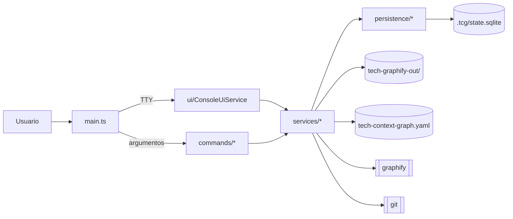

# Project Agent Guide

> **Verificado el 2026-11-05** sobre el working tree del mantenedor. Ese árbol incluía trabajo aún sin publicar en `main`: reconciliación de divergencias en `RepositoryGitService`, migración de exclusiones y `**/testdata/` en `ignore/common.graphifyignore`. Si esas piezas no están en tu checkout, esas secciones van por delante del código. Si el código contradice este documento, manda el código: corrige el documento.

## System Summary

**Tech Context Graph** (`tcg`, paquete `tech-context-graph` v4.0.0) es un CLI local que actúa como *plano de control* sobre [Graphify](integrations/integrations.md), un motor externo en Python que convierte código en grafos de conocimiento.

Resuelve este problema: una persona u organización tiene muchos repositorios de tecnologías (frameworks, librerías, aplicaciones) repartidos por el disco y quiere grafos actualizados y consultables de todos ellos, sin rutas supuestas ni modificar los repositorios.

Ciclo principal: el usuario crea un **workspace**, declara **raíces de búsqueda**, el sistema **detecta candidatos** y los clasifica con un catálogo de tecnologías, una persona los **acepta**, y Graphify los **inspecciona**. El grafo solo se **publica** tras validarlo y se recalcula únicamente si cambian la fuente o la configuración. Los grafos de una misma tecnología se **agregan**. Después se pueden **consultar**.

No hay servidor, API HTTP, autenticación, colas, ni frontend web. Hay un único proceso controlador por workspace. La versión con `apps/api` y PostgreSQL de `docs/en/11-architecture.md` y `ROADMAP.md` es **futuro, no existe**.

## Technology Stack

| Area | Technology |
|---|---|
| Language | TypeScript 5.9 `strict`, CommonJS, target ES2022, Node ≥ 20 |
| CLI / DI | NestJS 11 (`@nestjs/core`, solo application context), `nest-commander` 3 |
| UI de terminal | `@clack/prompts` 1.x (ESM, importado dinámicamente), `chalk` |
| Database | SQLite vía `sql.js` (WASM, en memoria, exportado a fichero). Sin ORM: SQL a mano |
| Configuración | YAML (`yaml`) validado con JSON Schema 2020-12 (`ajv`) |
| Motor externo | Graphify (`graphify` en PATH, Python, instalado con `uv`), `git`, `rg` opcional |
| Testing | Jest 30 + `ts-jest`, Git real en temporales, sin Graphify real |
| Infrastructure | GitHub Actions (Ubuntu + Windows, Node 20). Sin Docker ni despliegue |

## Repository Map

| Ruta | Responsabilidad | Tipo |
|---|---|---|
| `src/main.ts` | Entrypoint: TUI si hay TTY, si no `CommandFactory` | Fuente |
| `src/cli.module.ts` | Registro DI de **todos** los servicios y comandos | Fuente |
| `src/commands/` | Adaptadores `nest-commander`: parsean flags e imprimen | Fuente |
| `src/ui/` | TUI Clack y formateo de salida | Fuente |
| `src/services/` | Casos de uso y primitivas (Git, procesos, locks, rutas) | Fuente |
| `src/persistence/` | SQLite, migraciones, store | Fuente |
| `src/models/` | Tipos e interfaces de dominio | Fuente |
| `config/` | Catálogo de tecnologías, JSON Schema, YAML de ejemplo | Runtime, se publica |
| `ignore/` | Perfiles de exclusión por tecnología | Runtime, se publica |
| `test/` | Specs de Jest | Tests |
| `scripts/` | Limpieza, instaladores, smoke test real | Scripts |
| `docs/`, `diagrams/`, `*.md` raíz | Documentación de usuario EN/ES | Docs, se publican |
| `dist/` | Salida de `tsc` | Generado |
| `graphify-out/` | Grafo de **este** repo para navegar | Generado, ignorado |
| `.tcg/`, `tech-graphify-out/`, `context-pack/`, `tech-context-graph.yaml`, `tech-context-graph.workspace.json` | **Estado real de un workspace del usuario** que vive en esta raíz | Ignorado, **no tocar** |
| `internal-notes/`, `manual/`, `knowledge/`, `.tcg-install/`, `.codex/` | Notas y artefactos locales | Ignorado |

## Architecture

Monolito modular en capas dentro de un único módulo Nest (`CliModule`, más `ConfigurationModule` y `PersistenceModule`). No es hexagonal: no hay puertos ni interfaces de infraestructura, y `GraphifyCliService` es una clase concreta. El sistema reparte su estado entre YAML, SQLite y sistema de ficheros, y publica artefactos con un patrón de generaciones inmutables más puntero atómico.

Detalle en [architecture/overview.md](architecture/overview.md).

## Core Domains

- [Workspace](domains/workspace.md): carpeta de control, marcador, registro global, resolución.
- [Catálogo de repositorios](domains/repository-catalog.md): raíces, candidatos, tecnologías, identidad, aceptación.
- [Ciclo de vida del grafo](domains/graph-lifecycle.md): inspección, frescura, publicación, agregado.

## Main Features

| Funcionalidad | Entrada principal |
|---|---|
| [Onboarding de workspace](features/workspace-onboarding.md) | `tcg`, `workspace:*`, `start` |
| [Raíces de búsqueda](features/repository-roots.md) | `root:*`, menú 6 |
| [Descubrimiento](features/repository-discovery.md) | `repository:scan`, `root:scan`, `project:discover` |
| [Revisión del catálogo](features/catalog-review.md) | `repository:review`, menú 2 |
| [Inspección con Graphify](features/graph-inspection.md) | `repository:inspect`, menú 3 |
| [Pull + actualización](features/pull-and-update.md) | `repository:inspect --pull`, menú 4 |
| [Agregado por tecnología](features/technology-aggregation.md) | Al final de cada lote |
| [Consulta del grafo](features/graph-query.md) | Solo TUI, menú 5 |
| [Frescura y reconciliación](features/freshness-and-reconcile.md) | `repository:reconcile`, inicio de TUI |
| [Mantenimiento de repositorios](features/repository-maintenance.md) | `repository:classify`, `repository:set-source`, `project:*` |
| [Diagnóstico y configuración](features/diagnostics-and-config.md) | `doctor`, `config:*` |

## Critical Flows

1. **Publicación del grafo** (`GraphifyCliService.inspectLocked`): extraer en generación nueva → validar → re-comprobar fingerprint → escribir `tcg-current.json` atómicamente → marcar `READY`. Un fallo nunca destruye el grafo anterior.
2. **Coordinador de actualización** (`RepositoryUpdateService.run`): el único camino de escritura de grafos para CLI y TUI.
3. **Pull seguro** (`RepositoryGitService.pull`): modifica repositorios reales del usuario. Es el código con mayor radio de daño.
4. **Apertura de base de datos** (`SqliteDatabaseService.open`): toma el lock del workspace, migra, y la migración 9 **mueve carpetas**.
5. **Upsert de candidatos** (`RepositoryStoreService.upsertCandidate`): la lógica de `ON CONFLICT` decide qué sobrevive a un re-escaneo. Tiene [bugs conocidos](technical-debt/risks.md).

## Where to Look

| Task | Start Here |
|---|---|
| Añadir comando CLI | [workflows/add-command.md](workflows/add-command.md) |
| Añadir opción al menú interactivo | [cli/interactive-ui.md](cli/interactive-ui.md), `src/ui/console-ui.service.ts` |
| Cambiar el modelo de datos | [workflows/modify-database.md](workflows/modify-database.md) |
| Cambiar la configuración YAML | [workflows/change-configuration.md](workflows/change-configuration.md) |
| Detectar una tecnología nueva | [workflows/add-technology-profile.md](workflows/add-technology-profile.md) |
| Cambiar la invocación de Graphify | [integrations/integrations.md](integrations/integrations.md), `src/services/graphify-cli.service.ts` |
| Tocar Git o pull | [features/pull-and-update.md](features/pull-and-update.md), [modules/runtime-primitives.md](modules/runtime-primitives.md) |
| Investigar un bug | [workflows/fix-bug.md](workflows/fix-bug.md), [technical-debt/risks.md](technical-debt/risks.md) |
| Añadir un test | [workflows/add-test.md](workflows/add-test.md), [testing/test-map.md](testing/test-map.md) |
| Autenticación, endpoints o páginas web | **No existen en este proyecto** |

## Critical Rules

1. **La raíz del checkout puede ser un workspace real.** Si contiene el marcador y la base de datos del usuario (ignorados por Git), `resolveWorkspacePath` lo encuentra subiendo desde el cwd. Nunca ejecutes `tcg` o `node dist/main.js` con comandos de estado desde aquí. Usa `--workspace <temporal>` y `TCG_CONFIG_HOME=<temporal>`.
2. **Procesos solo con array de argumentos** mediante `runProcess`/`runGit`, con `shell: false`. Nunca interpoles rutas en un shell.
3. **Nunca modifiques una generación publicada** ni `tcg-current.json` fuera del flujo de publicación. Un fallo debe conservar el grafo anterior.
4. **Los repositorios del usuario no se tocan** salvo las operaciones Git explícitas de `RepositoryGitService` y `.git/info/exclude`. Nunca `clean`, `stash` ni `reset --hard` automáticos.
5. **Solo se actualizan repositorios `ACCEPTED` y `enabled`.** La aceptación humana no se salta.
6. **Las migraciones son append-only.** Nunca edites una versión ya existente de `SqliteMigrationService`.
7. **Estado en disco: temporal + `rename`.** Sigue el patrón existente al escribir estado o publicaciones.
8. **Todo servicio o comando nuevo se registra en `CliModule`.** Si no, no existe.
9. **No ejecutes el código con tsx ni otro transpilador con esbuild.** No emiten metadata de decoradores y la DI falla. Usa `npm run dev -- <comando>` (compila con `tsc`), `node dist/main.js` o Jest.
10. **`npm run build` borra `dist/` primero**, y el `tcg` enlazado globalmente apunta ahí.
11. **No reviertas cambios ajenos sin commitear**, y nunca versiones estado local del workspace.

## Documentation Index

- **Arquitectura:** [overview](architecture/overview.md) · [boundaries](architecture/boundaries.md) · [dependency-rules](architecture/dependency-rules.md) · [data-flow](architecture/data-flow.md)
- **Dominios:** [workspace](domains/workspace.md) · [repository-catalog](domains/repository-catalog.md) · [graph-lifecycle](domains/graph-lifecycle.md)
- **Funcionalidades:** [workspace-onboarding](features/workspace-onboarding.md) · [repository-roots](features/repository-roots.md) · [repository-discovery](features/repository-discovery.md) · [catalog-review](features/catalog-review.md) · [graph-inspection](features/graph-inspection.md) · [pull-and-update](features/pull-and-update.md) · [technology-aggregation](features/technology-aggregation.md) · [graph-query](features/graph-query.md) · [freshness-and-reconcile](features/freshness-and-reconcile.md) · [repository-maintenance](features/repository-maintenance.md) · [diagnostics-and-config](features/diagnostics-and-config.md)
- **Módulos:** [bootstrap](modules/bootstrap.md) · [commands](modules/commands.md) · [console-ui](modules/console-ui.md) · [workspace-services](modules/workspace-services.md) · [technology-detection](modules/technology-detection.md) · [graph-engine](modules/graph-engine.md) · [runtime-primitives](modules/runtime-primitives.md) · [configuration](modules/configuration.md) · [persistence](modules/persistence.md)
- **CLI** (sustituye a backend/frontend): [command-reference](cli/command-reference.md) · [interactive-ui](cli/interactive-ui.md)
- **Datos:** [database](data/database.md) · [models](data/models.md) · [migrations](data/migrations.md) · [filesystem-artifacts](data/filesystem-artifacts.md)
- **Integraciones:** [integrations](integrations/integrations.md)
- **Testing:** [strategy](testing/strategy.md) · [test-map](testing/test-map.md)
- **Operaciones:** [local-development](operations/local-development.md) · [build](operations/build.md) · [distribution](operations/distribution.md) · [troubleshooting](operations/troubleshooting.md)
- **Convenciones:** [code-style](conventions/code-style.md) · [naming](conventions/naming.md) · [architectural-rules](conventions/architectural-rules.md)
- **Workflows:** [add-feature](workflows/add-feature.md) · [add-command](workflows/add-command.md) · [fix-bug](workflows/fix-bug.md) · [modify-database](workflows/modify-database.md) · [change-configuration](workflows/change-configuration.md) · [add-technology-profile](workflows/add-technology-profile.md) · [add-test](workflows/add-test.md)
- **Reglas para agentes:** [coding-agent](agent-rules/coding-agent.md) · [review-agent](agent-rules/review-agent.md) · [navigation](agent-rules/navigation.md)
- **Deuda técnica:** [risks](technical-debt/risks.md) · [opportunities](technical-debt/opportunities.md)

**Omitidos a propósito:** `frontend/` y `backend/api` (no hay web ni HTTP), `add-endpoint` (equivale a `add-command`), bounded contexts y aggregates (el proyecto no usa DDD formal).
