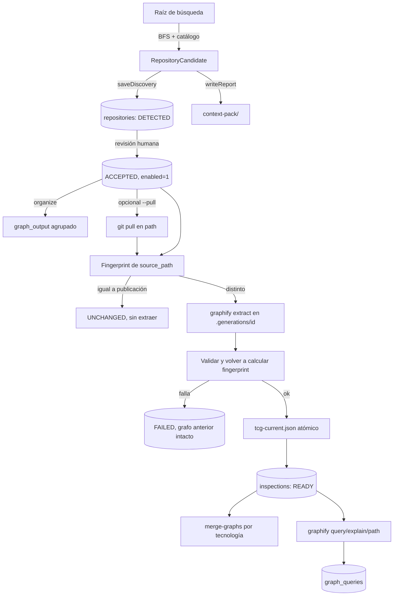
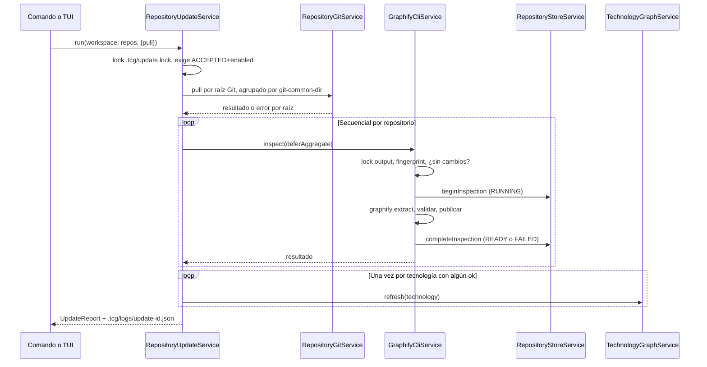

# Data Flow

## Flujo completo

## Secuencia de `repository:inspect --pull`

## Identidad a través del flujo

| Etapa | Forma | Convención |
|---|---|---|
| Escáner | `RepositoryCandidate` | `snake_case`, también el JSON y YAML del informe |
| Conversión | `candidateToStored()` | Cambia a `camelCase` |
| SQL | `RepositoryRow` | `snake_case`, listas como `*_json` |
| Dominio | `StoredRepository` | `camelCase`, mapeado en `mapRow` |

Añadir un campo implica tocar las cuatro formas: [workflows/modify-database.md](../workflows/modify-database.md).

## Dos rutas distintas en cada repositorio

| Campo | Uso |
|---|---|
| `path` | Identidad (único) y **donde se hace `git pull`** |
| `sourcePath` | **Lo que inspecciona Graphify** y lo que se usa para el fingerprint |

Se separan con `repository:set-source`. Confundirlos es un bug silencioso.

## Estado derivado en lectura

`inspectionStatus` no es una columna; se calcula en tres pasos:

1. `RepositoryStoreService.list`: toma el estado de la **última** inspección, o `NEVER`.
2. `mapRow`: `READY` sin `graph.json` en disco → `MISSING`.
3. `RepositoryControlService.list`/`get`: fuente ausente → `MISSING`; `READY` con fingerprint distinto → `STALE`.

Si lees directamente del store no verás `STALE` calculado. `graphJsonPath`, `nodeCount` y `edgeCount` usan `COALESCE` con la última inspección `READY`, por lo que un repositorio con estado `FAILED` conserva el grafo válido anterior.

## Efectos laterales fuera del workspace

| Efecto | Cuándo |
|---|---|
| `git pull`, `reset --keep`, `rebase`, `restore`, ref `refs/tcg/backups/*` en el repositorio | Solo con `--pull` |
| `.git/info/exclude`, `info/tcg-backups/` | Con `--pull`, o al crear un workspace dentro de un repositorio Git |
| `.graphifyignore` en el repositorio | Solo `project:prepare --write-ignore` |
| Registro global | Crear, adoptar o usar un workspace |
