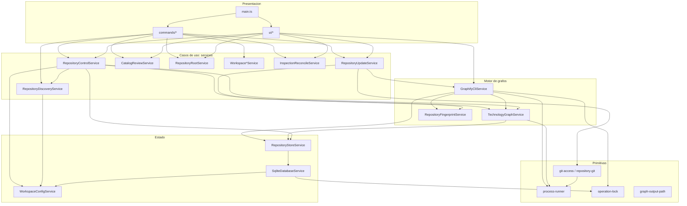
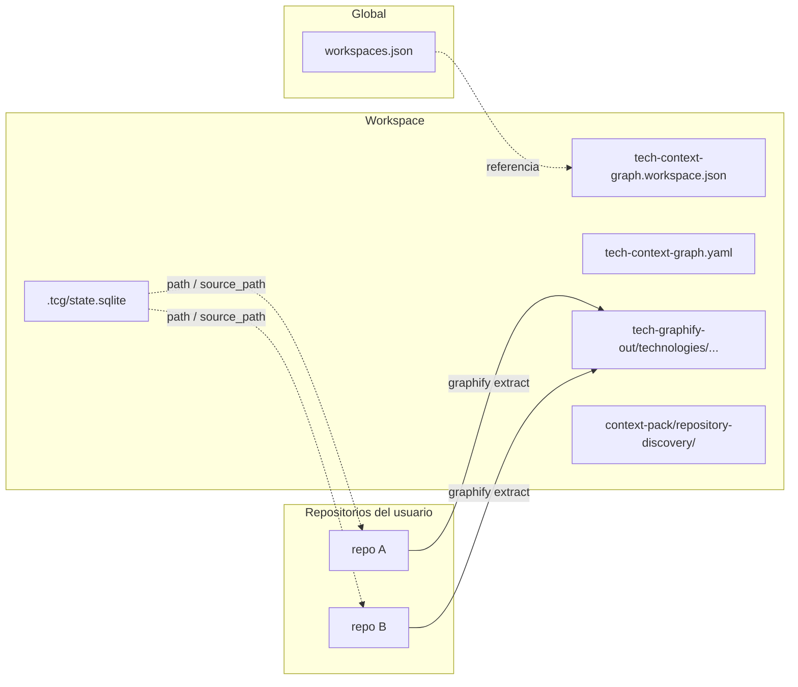

# Architecture Overview

## Estilo real

**Monolito modular en capas, de un solo proceso, sobre el contenedor DI de NestJS.** No hay microservicios, eventos, CQRS ni DDD formal.

Patrones que sí existen en el código:

| Patrón | Dónde | Nota |
|---|---|---|
| Service Layer | `src/services/*` | Casos de uso invocados desde dos adaptadores |
| Presentation Adapter | `src/commands/*`, `src/ui/*` | CLI y TUI comparten servicios |
| Repository (informal) | `RepositoryStoreService` | Único acceso al SQL de dominio |
| Publicación atómica por generaciones | `GraphifyCliService` | Directorios inmutables más puntero `tcg-current.json` |
| Coordinador de lote | `RepositoryUpdateService` | Único orquestador de pull, inspección y agregado |
| Lock file con recuperación | `operation-lock.ts` | Exclusión entre procesos locales |

Lo que **no** existe aunque la documentación lo sugiera: `docs/en/11-architecture.md` dice que Graphify queda "detrás de un puerto" y plantea `apps/api` y `apps/worker`. Hoy no hay interfaz de puerto ni más aplicaciones; `src/` es una única aplicación.

## Aplicación y entrypoints

Solo hay una aplicación, con dos binarios que apuntan al mismo fichero (`tech-context-graph` y `tcg` → `dist/main.js`).

`src/main.ts` decide el modo:

- **Sin argumentos o `ui`, con stdin y stdout TTY:** crea un application context, resuelve o elige workspace y entra en el bucle de `ConsoleUiService`. El resultado `SWITCH_WORKSPACE` repite el bucle.
- **Cualquier otro caso:** `CommandFactory.run(CliModule)`, modo comando no interactivo.

## Capas

Responsabilidades y límites de cada capa: [boundaries.md](boundaries.md).

## Nodos más conectados

Según `graphify-out/GRAPH_REPORT.md`, cambiarlos tiene el mayor radio de impacto: `RepositoryStoreService` (52 aristas), `StoredRepository` (46), `WorkspaceConfigService` (46), `resolveWorkspacePath()` (32), `RepositoryDiscoveryService` (31), `GlobalWorkspaceRegistryService` (30), `SqliteDatabaseService` (29), `GraphifyCliService` (29), `ConsoleUiService` (28).

## Topología de un workspace

El **workspace** (estado) y los **repositorios** (datos) son carpetas separadas: el código fuente nunca se copia.

## Decisiones que explican el código

- **`sql.js` en vez de SQLite nativo:** sin compilación nativa. Coste: la BD vive en memoria y se exporta entera en cada escritura, de ahí el lock de proceso único.
- **Graphify como subproceso:** es Python, se integra por CLI y se parsea su salida. Por eso hay detección de capacidades con `--help`.
- **Doble almacén YAML y SQLite:** la configuración editable va en YAML y el historial de ejecución en SQLite. La frontera está incompleta ([R-15](../technical-debt/risks.md)).
- **Un solo módulo con todos los providers:** evita ciclos entre módulos y facilita añadir cosas, pero Nest no impone ninguna frontera.
