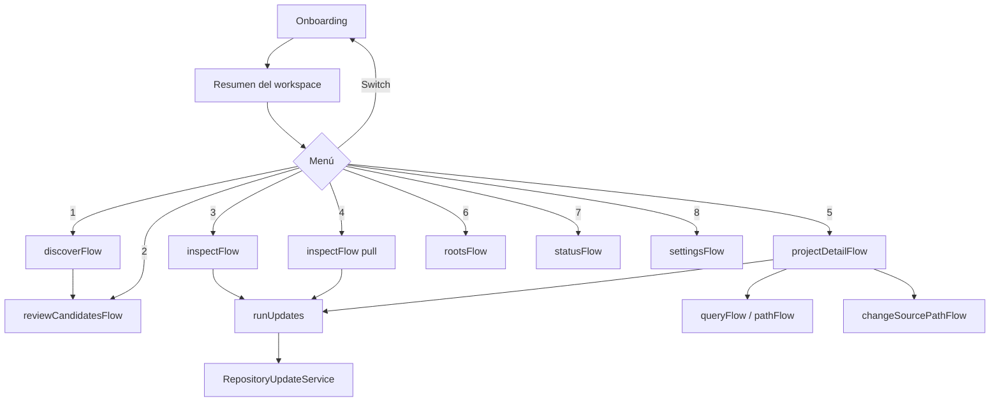

# UI interactiva

Implementada en `src/ui/console-ui.service.ts` con Clack. Es la interfaz principal; no hay frontend web. Arquitectura en [modules/console-ui.md](../modules/console-ui.md).

## Mapa de navegación

## Menú de detalle de proyecto

`update`, `pull-update`, `rebuild` (`--force`), `source`, `query`, `explain`, `path`, `location`, `disable`, `back`.

## Patrones para añadir un flujo

1. Método privado `xFlow(root)` que empieza con `const clack = await this.prompts.load();`.
2. Toda respuesta pasa por `this.prompts.requireValue(await clack.xxx(...))`.
3. Ofrece siempre opción `back` en listas.
4. Confirma con `clack.confirm` antes de escribir o de operaciones caras.
5. Usa `spinner` o `progress`, y separa éxito y fallo (`spinner.stop` / `spinner.error`).
6. Cualquier actualización pasa por `this.updates.run`, y luego `repositories.invalidate(root)`.
7. Añade la opción en `run` y el caso en su `switch`.

## Convenciones

- Búsqueda: `autocomplete` y `autocompleteMultiselect` con `filter: this.presenter.matches`.
- Formato y símbolos de estado: `RepositoryUiPresenterService`.
- Textos en inglés. Los manuales están en EN y ES, la UI no.

## Comportamientos que parecen bugs y no lo son

- "All pending repositories" selecciona **todos**: el coordinador omite los que no han cambiado.
- Inmediatamente tras abrir, el estado puede ser antiguo; el resumen lo indica.
