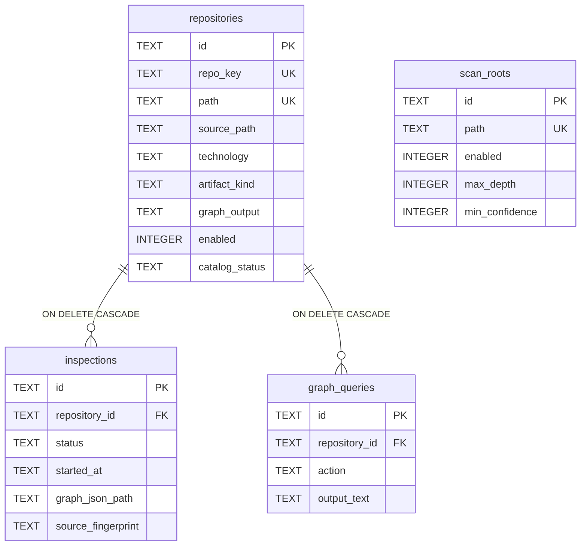

# Base de datos

SQLite en `<workspace>/.tcg/state.sqlite` (configurable con `persistence.file`), accedida mediante `sql.js`, en memoria y exportada a disco. Sin ORM. Esquema en `src/persistence/sqlite-migration.service.ts`.

## Modelo

## Tablas

| Tabla | Propósito | Notas |
|---|---|---|
| `repositories` | Catálogo | Listas como JSON: `markers_json`, `technology_constraints_json`, `classification_evidence_json` |
| `inspections` | Historial, una fila por ejecución | Índice `(repository_id, started_at DESC)`. También guarda `command_text`, `log_path`, `graphify_version` |
| `scan_roots` | Raíces | También en YAML |
| `graph_queries` | Log de consultas | **Se escribe, nunca se lee** |
| `settings` | Clave-valor | **Sin uso** |
| `schema_migrations` | Versiones aplicadas | |

Fechas en ISO-8601 como `TEXT`; booleanos como `INTEGER`.

## Inspeccionar sin riesgo

`sqlite3` sobre `.tcg/state.sqlite` no ve el lock. Con una sesión `tcg` abierta, cualquier cambio manual **será sobrescrito** en la siguiente exportación. Solo lectura, con `tcg` cerrado, y siempre haz copia antes.
