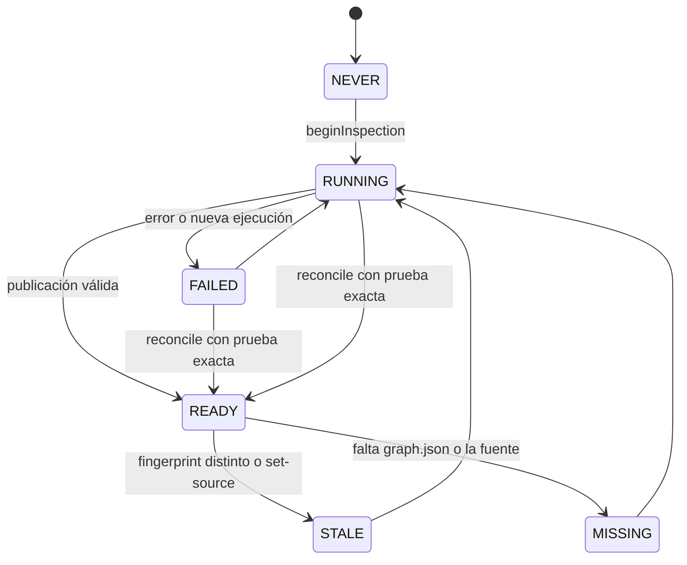

# Dominio: Ciclo de vida del grafo

## Conceptos

| Término | Definición |
|---|---|
| Inspección | Una ejecución registrada en `inspections` |
| Generación | Directorio inmutable `<output>/.generations/<runId>/` con una extracción |
| Publicación | `<output>/tcg-current.json`, el puntero al grafo válido actual |
| Fingerprint | Hash de la fuente: `git-v2:` si es Git, `files-v2:` si no, o `missing` |
| Hash de configuración | Hash de esquema, fuente, ignores, versión de Graphify y modo de clustering |
| Agregado | Fusión de los grafos `READY` de una tecnología |

## Estado de inspección

| Estado | ¿Persistido? | Origen |
|---|---|---|
| `NEVER` | No | Sin filas en `inspections` |
| `RUNNING`, `READY`, `FAILED` | Sí | `beginInspection`, `completeInspection` |
| `STALE` | A veces | Calculado en `RepositoryControlService`; persistido por `updateSourcePath` |
| `MISSING` | No | Calculado en `mapRow` y `RepositoryControlService` |

## Invariantes de publicación

1. **Un fallo nunca destruye el grafo anterior:** cada extracción usa una generación nueva.
2. **Publicar exige todo esto:** JSON válido, arrays de nodos y aristas, ids únicos, 0 aristas colgantes (se reparan con aviso), **fingerprint idéntico antes y después de extraer**, sin cancelación.
3. **El puntero es atómico:** temporal + `rename`.
4. **`tcg-current.json.graph` debe ser relativo y dentro de `.generations/`:** `publishedGraph` rechaza lo demás.
5. **Un grafo válido antiguo no prueba que una ejecución fallida posterior funcionara:** reconcile exige coincidencia exacta de `inspectionId`, fingerprint y digest.
6. **Una generación corrupta no siembra la siguiente:** solo se copia para modo incremental si el digest coincide y no hay aristas colgantes.
7. **Una extracción por salida a la vez:** `<output>/.tcg-inspection.lock`.

## Cuándo se omite la extracción

Se devuelve `unchanged: true` si **todo** se cumple: sin `--force`, igual hash de configuración, igual fingerprint, y grafo con digest válido y sin aristas colgantes.

Si además el estado registrado no era `READY`, se crea una inspección de verificación `tcg verified existing publication`.

## Qué invalida el fingerprint

**Fuente Git:** ruta, `HEAD`, `git status` con untracked, `.gitignore` y `.graphifyignore` desde la fuente hasta la raíz, `info/exclude`, diff staged, y contenido de ficheros cambiados.

**Sin Git:** ruta relativa y contenido de cada fichero, excluyendo `.git`, `node_modules`, `vendor`, `dist`, `build`, `coverage`, `.next`, `.nuxt`, `.output`, `.tcg`, `graphify-out` y `tech-graphify-out`.

Un repositorio Git roto **da error**; nunca se degrada a escaneo de ficheros.

## Resultados por repositorio (`UpdateOutcome`)

| Campo | Valores |
|---|---|
| `status` | `UPDATED`, `UNCHANGED`, `SKIPPED`, `BLOCKED`, `FAILED`, `CANCELLED` |
| `gitStatus` | Igual; `SKIPPED` si no hubo `--pull` |
| `graphStatus` | `UPDATED`, `UNCHANGED`, `PRESERVED` (sigue el anterior), `UNAVAILABLE` |

`BLOCKED` corresponde a los códigos `LOCAL_CHANGES`, `OWNERSHIP`, `PERMISSION`, `DIVERGED`, `NO_UPSTREAM`, `DETACHED_HEAD`, `LOCKED`.

`EMPTY_GRAPH` (solo documentación, sin símbolos) cuenta como `ok` con estado `SKIPPED`, pero la fila de `inspections` queda `FAILED` ([R-17](../technical-debt/risks.md)).
