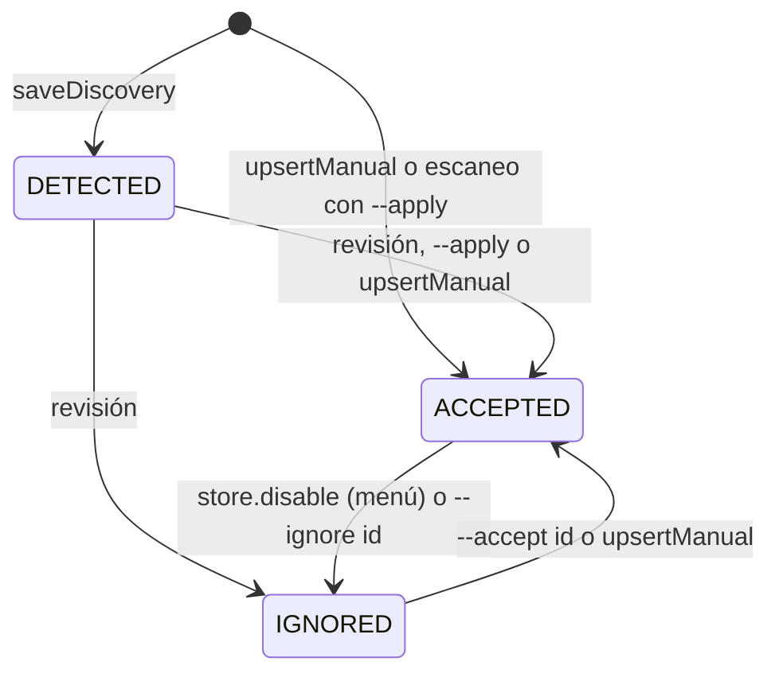

# Dominio: Catálogo de repositorios

## Conceptos

| Término | Definición |
|---|---|
| Raíz de búsqueda (*repository root*) | Árbol de carpetas elegido explícitamente para escanear (`ScanRootRecord`) |
| Candidato | Carpeta detectada a la espera de decisión humana (`RepositoryCandidate`, estado `DETECTED`) |
| Repositorio aceptado | Permitido para inspección (`StoredRepository`, `ACCEPTED`) |
| Tecnología (*technology*) | Id de perfil del catálogo (`nestjs`, `vue`, `unknown`) |
| Perfil | Reglas de detección y clasificación (`TechnologyProfile`) |
| `artifactKind` | `core`, `library`, `application`, `unknown` |
| `packageEcosystem` | `npm`, `composer`, `maven`, `gradle`, `unknown` |
| Miembro compuesto | Hijo de una carpeta contenedora agrupado bajo una tecnología (marcador `member_of:<id>`) |
| `role` | `technology`, `library`, `application`, `backend`, etc. Texto libre en SQLite, enum en el schema YAML |

## Estado del catálogo

`REJECTED` y `MISSING` existen en el tipo `CatalogStatus`, pero **ningún código los escribe**.

`setCatalogStatus` fija `enabled=1` solo para `ACCEPTED`. Si falla `organize` al aceptar, se restaura el estado anterior.

## Reglas de identidad

| Campo | Regla |
|---|---|
| `path` | Único. **Identidad real**; es el objetivo del `ON CONFLICT` |
| `key` (`repo_key`) | Único. Lo usa el usuario en el CLI |
| `id` | `REPO-CAND-<sha1 10 hex>` si se descubre; `REPO-<sha1 12 hex>` si es manual. Hash de la ruta en minúsculas |
| Raíz | `ROOT-<sha1 12 hex>` de la ruta |

Generación de la key (`proposeKey`):

- `core` → `<technology>-core-<major|unknown>`
- `library` → alias del perfil, o `packageKey(nombre)`
- Resto → alias, o `<technology>`, `<technology>-<version>`, `<technology>-<carpeta>`
- `unknown` → slug de la carpeta

Colisiones dentro de un mismo escaneo → sufijo `-2`. **Entre escaneos no se resuelven** ([R-03](../technical-debt/risks.md)).

## Clasificación

`classifyRepositoryManifest` en `src/services/repository-manifest.service.ts`:

1. **core:** el nombre del manifiesto está en `core_package_names_any`, o la carpeta en `core_repository_names_any`.
2. **library:** explícita por `library_package_names_any`, o por forma del manifiesto:
   - composer: `type` de librería o `extra` coincidente
   - npm: peer dependency coincidente, o público con dependencia coincidente
   - maven/gradle: dependencias coincidentes sin plugin Spring Boot
3. **application:** manifiesto conocido sin lo anterior.
4. **unknown:** sin manifiesto reconocido.

`technologyVersion` solo se calcula para `core` y `technologyConstraints` son solo majors declarados. **No se resuelven versiones semver.**

## Invariantes

- Discovery nunca mueve ni modifica repositorios.
- Solo `ACCEPTED` con `enabled=1` entra en `RepositoryUpdateService`; si no, todo el lote falla con `NOT_ACCEPTED`.
- Por defecto `store.list` devuelve solo aceptados y habilitados. `getById` y `getByKey` devuelven cualquier estado.
- Un re-escaneo preserva `catalog_status` y `enabled`, salvo promover `DETECTED` con `--apply`, y, en aceptados, `source_path` y `graph_output`. **No preserva la clasificación manual** ([R-02](../technical-debt/risks.md)).
- Todo repositorio con tecnología conocida vive en `technologies/<technology>/<key>`. Con `unknown`, en `technologies/<key>`.
