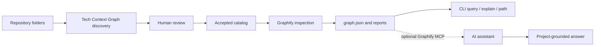

# Tech Context Graph

> A local control plane that turns a folder full of software repositories into a reviewed, queryable, and maintainable knowledge catalog for humans and AI assistants.

[English documentation](docs/en/README.md) · [Documentación en español](docs/es/README.md) · [Quick start](QUICK_START.md) · [Inicio rápido](QUICK_START_ES.md) · [Architecture diagrams](diagrams/README.md)

## The problem it solves

An AI assistant can read source code, but reading files is not the same as understanding a system.

In a real engineering workspace, knowledge is spread across repositories, frameworks, modules, configuration files, generated artifacts, and historical decisions. Without a reliable map, an assistant may:

- inspect unrelated files repeatedly;
- miss relationships that cross folders or repositories;
- suggest generic Stack Overflow-style solutions that do not fit the project;
- confuse an application's architecture with a framework's source code;
- use stale assumptions after the code changes;
- produce confident answers without showing where the evidence came from.

Tech Context Graph addresses the operational part of that problem. It helps you decide which repositories belong to your catalog, classify them, build a Graphify knowledge graph for each one, track whether every graph is current, and query the resulting context from one workspace.

The goal is not to stop an AI from ever using the internet. The goal is to make project-specific evidence the first place it looks.

## A concrete example

Imagine a company with these repositories:

```text
repositories/
├── checkout-api/          NestJS application
├── customer-portal/       React application
├── shared-auth/           Internal TypeScript library
├── laravel-legacy/        Laravel application
└── framework-sources/
    ├── vue/
    └── router/
```

A junior developer asks:

> “Where should I add authorization for the refund endpoint?”

A generic assistant might explain JWT middleware or search the web for a NestJS tutorial. A graph-aware assistant can first investigate the actual system:

```text
refund endpoint
  -> RefundController
  -> RefundService
  -> PermissionGuard
  -> shared-auth policy package
  -> audit event publisher
```

That answer is more useful because it is grounded in the repository's real symbols and relationships. The assistant can explain not only *how authorization usually works*, but *where this project already implements it*.

## What Tech Context Graph does

Tech Context Graph provides a safe workflow around Graphify:

1. **Create or open a workspace.** A workspace stores the catalog, graph locations, logs, and operational history. It is not a source repository.
2. **Register repository search roots.** You explicitly choose where repositories may be discovered. No personal folder is guessed.
3. **Detect technologies from evidence.** The scanner examines files and dependencies such as `package.json`, `composer.json`, `nest-cli.json`, `artisan`, `pubspec.yaml`, `pom.xml`, `.csproj`, `go.mod`, and `Cargo.toml`.
4. **Review before accepting.** Detection creates candidates. A human decides which repositories enter the managed catalog.
5. **Build knowledge graphs with Graphify.** Accepted repositories can be inspected individually or in a selected batch.
6. **Track freshness.** The catalog records whether a graph is ready, stale, failed, missing, or has never been built.
7. **Query the evidence.** From the interactive UI you can ask a question, explain a concept, or find a path between two nodes.
8. **Aggregate related technology repositories.** Repositories that form one technology family can be organized into a shared technology graph while retaining member outputs.

## What it does not do

Clear boundaries make the project easier to trust:

- It does not move or rewrite your repositories during discovery.
- It does not silently accept every detected folder.
- It does not treat a folder name as proof of a technology.
- It does not replace Git, an IDE, documentation, tests, or architectural review.
- It does not guarantee that every AI answer is correct.
- It does not currently implement its own MCP server.

Graph creation, traversal, and optional MCP serving are Graphify capabilities. Tech Context Graph manages the catalog and lifecycle around those graphs.

## Mental model for beginners

Think of the system as a university library:

| Software concept | Library analogy |
|---|---|
| Repository search root | A building in which books may be found |
| Detected repository | A book waiting to be cataloged |
| Accepted repository | A book approved for the library collection |
| Graphify graph | The index of concepts and relationships inside the book |
| Workspace | The library catalog and administration office |
| Graph query | Asking the librarian where two ideas connect |
| MCP exposure | Giving an AI assistant controlled access to the index |

The source code remains the authority. The graph is a navigational index over that authority.

## How the pieces fit together



The human review step is intentional. Automation should reduce repetitive work without hiding consequential decisions.

## Installation from source

### Requirements

- Node.js 20 or newer
- Python 3.10 or newer
- Git
- Graphify (`graphifyy`)
- `uv` is recommended for Python tool installation

Install Graphify:

```bash
uv tool install graphifyy
```

Build and link Tech Context Graph:

```bash
npm install
npm run build
npm link
```

Check the environment:

```bash
tcg doctor
```

See [INSTALLATION.md](INSTALLATION.md) for platform notes and upgrades.

## Five-minute workflow

Start the interactive UI:

```bash
tcg
```

Then follow this sequence:

```text
Create or open a workspace
  -> Repository search folders
  -> Add a repository search folder
  -> Discover repositories
  -> Review detected repositories
  -> Inspect with Graphify
  -> Pull latest code + update graphs (select all or choose one or more)
  -> Project details and source folders
  -> Query / Explain / Path
```

Every nested menu includes a `Back` option where navigation requires it.

### Non-interactive example

```bash
tcg workspace:create \
  --path "/opt/tcg/company-catalog" \
  --name "Company Catalog" \
  --non-interactive

tcg root:add "/srv/repositories" \
  --workspace "/opt/tcg/company-catalog"

tcg root:list --workspace "/opt/tcg/company-catalog"
tcg root:scan <root-id> --workspace "/opt/tcg/company-catalog"
tcg repository:review --accept-all --workspace "/opt/tcg/company-catalog"
tcg repository:list --workspace "/opt/tcg/company-catalog"
tcg repository:set-source api "/srv/repositories/platform/packages/api" \
  --workspace "/opt/tcg/company-catalog"
tcg repository:inspect api --pull \
  --workspace "/opt/tcg/company-catalog"
```

`repository:review --accept-all` accepts every candidate currently awaiting review. Individual failures remain pending, are reported, and make the command exit with status `1`.

`repository:set-source` changes the directory Graphify inspects while preserving the repository's catalog identity. The interactive UI exposes the same action under **Project details and source folders**.

`repository:inspect --pull` first runs `git pull --ff-only` in the original registered repository folder. Graphify starts only after a clean, successful fast-forward or an already-up-to-date result, and continues to inspect the configured source folder. Local changes, detached `HEAD`, missing upstream branches, authentication failures and divergent histories stop the graph update without modifying Git state automatically. See [Git pull before graph inspection](docs/en/15-git-pull-before-inspection.md) or [Git pull antes de actualizar el grafo](docs/es/15-git-pull-antes-inspeccion.md).

Use `tcg <command> --help` to inspect the exact options supported by a command.

## Graph states

The graph lifecycle tells both humans and automation how much confidence to place in an artifact:

| State | Meaning | Recommended action |
|---|---|---|
| `NEVER` | Accepted, but never inspected | Build the graph |
| `RUNNING` | Inspection is in progress | Wait or reconcile after an interruption |
| `READY` | Graph matches the stored source fingerprint | Query it |
| `STALE` | Source changed after the last successful build | Update the graph |
| `FAILED` | Last inspection failed | Read the log, fix the cause, retry |
| `MISSING` | Source folder or graph artifact is unavailable | Restore the path or rebuild |

This matters for AI use: a `READY` graph is stronger context than a graph known to be stale.

## Using the graph with an AI assistant

There are two levels of integration.

### 1. Query through Tech Context Graph

Open `Inspected project details` and choose:

- `Query the graph`
- `Explain a node or concept`
- `Find a path between two nodes`

Example questions:

```text
What calls PaymentService?
Where is authentication enforced?
Explain the repository discovery flow.
Find a path from CheckoutController to AuditPublisher.
Which modules depend on the shared configuration service?
```

Good questions name a project concept and ask for a relationship. “Explain the entire codebase” is usually less useful than “How does a repository move from detected to accepted?”

### 2. Expose a Graphify graph through MCP

Graphify can optionally expose graph tools through the Model Context Protocol. This allows a compatible AI client to query the maintained graph as a tool instead of scanning the whole repository or relying immediately on web search.

This is an advanced Graphify workflow, not a built-in `tcg` MCP server. Run it only for a graph whose privacy classification and freshness you understand. Consult your installed Graphify version:

```bash
graphify --help
graphify <repository-path> --mcp
```

The exact client configuration depends on the AI host. See [AI and MCP integration](docs/en/14-ai-and-mcp.md) for the architecture, safe usage, prompt examples, and limitations.

## Repository and workspace layout

```text
workspace/
├── tech-context-graph.workspace.json   # workspace identity
├── tech-context-graph.yaml             # editable configuration
├── .tcg/
│   ├── state.sqlite                    # catalog and inspection history
│   └── logs/                           # execution logs
├── tech-graphify-out/
│   └── technologies/                   # managed graph outputs
└── context-pack/                       # generated discovery reports
```

Run this command instead of guessing paths:

```bash
tcg config:paths
```

## Documentation map

Choose a learning path:

- **New user:** [Overview](docs/en/00-overview.md) → [First run](docs/en/01-first-run.md) → [Repository roots](docs/en/03-repository-roots.md) → [Detection and review](docs/en/04-detection-and-review.md) → [Graphify inspection](docs/en/05-graphify-inspection.md)
- **AI integration:** [AI and MCP integration](docs/en/14-ai-and-mcp.md)
- **Operator:** [Configuration](docs/en/07-configuration.md) → [Security](docs/en/08-security.md) → [Troubleshooting](docs/en/09-troubleshooting.md)
- **Contributor:** [Architecture](docs/en/11-architecture.md) → [Roadmap](docs/en/12-roadmap.md)
- **Spanish:** [Índice de documentación](docs/es/README.md)

The complete bilingual map is available in [docs/README.md](docs/README.md).

## Engineering principles

- **Explicit paths:** the application does not guess where your repositories live.
- **Human approval:** discovery proposes; a person accepts.
- **Evidence before inference:** technology classification uses files and dependencies.
- **Visible state:** catalog and graph states are separate and auditable.
- **Local-first operation:** SQLite and filesystem artifacts support a single-user local workflow.
- **Replaceable boundaries:** Graphify runs behind a service boundary; UI and application logic are separated.
- **Honest context:** stale, failed, and missing graphs are never presented as current.

## Development

```bash
npm install
npm run lint:types
npm test
npm run build
```

The test suite covers discovery, persistence, Graphify command handling, workspace resolution, and presentation behavior.

## Security and privacy

Knowledge graphs can reveal internal architecture, names, paths, and relationships even when they do not contain full source files. Treat graph artifacts as engineering data:

- inspect repository scope before building;
- keep workspaces in approved locations;
- review `.graphifyignore` rules;
- do not expose MCP endpoints publicly without authentication and network controls;
- rebuild or revoke artifacts when repository access changes;
- never assume that “local” automatically means “safe.”

Read the [security guide](docs/en/08-security.md) before sharing graphs outside a development machine.

## Project status

The current release is a CLI-first local control plane. The service boundaries are designed for future API and worker applications, but those server components should not be considered implemented until they exist in the repository.

## License

Released under the [MIT License](LICENSE).

### Efficient repository updates

`tcg repository:inspect all --pull` uses the same coordinator as the interactive menu. Git pulls are grouped by real root; Graphify only extracts changed inputs, and each affected technology aggregate is refreshed once. The initial menu shows stored state while freshness is checked asynchronously. Logs include separate Git/graph outcomes and wall-clock timings. See [update, local-ignore migration and recovery rules](docs/en/15-git-pull-before-inspection.md). Run `node scripts/verify-update.cjs` after building for a real Graphify smoke test against temporary local repositories.
