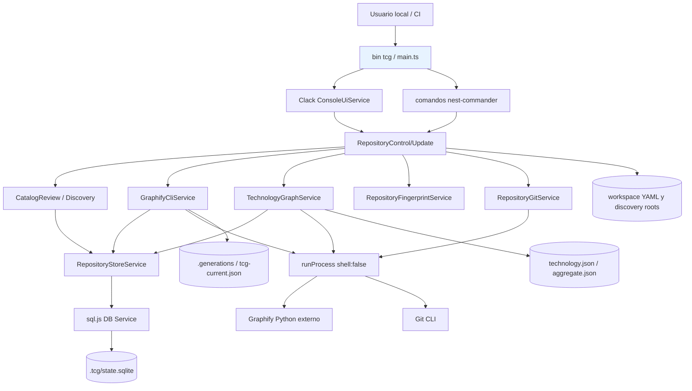
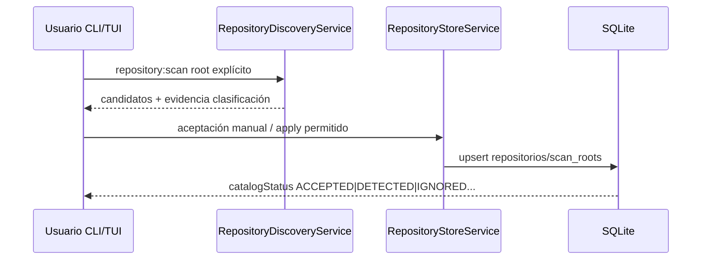
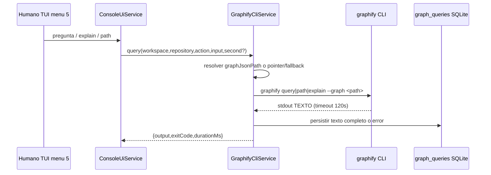

# 02 · Arquitectura actual demostrada (snapshot 6df893c)

## 1. Inventario real

- **Runtime:** `package.json:L1-L10,L29-L65` NestJS 11 + nest-commander 3 + TypeScript 5.9 CommonJS, Node >=20, Clack, AJV/YAML, `sql.js` SQLite. Entradas `tcg` y `tech-context-graph` apuntan a `dist/main.js`.
- **Bootstrap/DI:** `src/main.ts`, `src/cli.module.ts:L37-L93`, `src/configuration.module.ts`, `src/persistence.module.ts`. Monolito CLI modular por capas, **no arquitectura hexagonal completa**; no existe servidor HTTP en árbol `src` inspeccionado.
- **Adaptadores externos:** `src/services/graphify-cli.service.ts`, `src/services/process-runner.ts:L18-L69` (spawn shell:false, timeout), `src/services/repository-git.service.ts:L38-L107` (Git real), `src/services/operation-lock.ts`.
- **Aplicación:** `src/services/repository-update.service.ts:L30-L108` coordina pull/inspect/aggregate; `repository-control`, `catalog-review`, discovery, path/workspace y graph tech.
- **Persistencia:** `src/persistence/sqlite-database.service.ts:L26-L121` `sql.js` export + rename, migrations SQLite `sqlite-migration.service.ts`, `repository-store.service.ts`. Estado también reside en YAML y FS; no transacción ACID distribuida sobre los tres.
- **Modelo:** `src/models/repository-state.ts`, `repository-discovery.ts`, `workspace.ts`.
- **UX:** `src/commands/*` (p.ej. `repository:list|scan|inspect|reconcile|classify|set-source`), `src/ui/console-ui.service.ts` con menú de consulta `query/explain/path`.
- **Tests:** 18 suites de Jest en `test/`; Git temporal real, Graphify parcialmente real (test migración exige binario `graphify`). Workflow Linux/Windows `.github/workflows/quality.yml:L8-L37`.

## 2. Diagrama componentes actuales, NO E2E ARGEns



> Este dibujo es lectura arquitectónica E-R, no prueba de despliegue ni de un usuario final.

## 3. Flujos reales

### 3.1 Catálogo y revisión



La aceptación no debe inferirse de un nombre; `src/persistence/repository-store.service.ts:L25-L38,L53-L94,L149-L155` muestra persistencia. **Riesgo verificado en código + documentado**: `upsertCandidate` y colisiones pueden cambiar clasificaciones manuales; `.agents/technical-debt/risks.md:L7-L21` afirma reproducción en aislamiento, no reproducida de nuevo por esta auditoría.

### 3.2 Inspección/publicación inmutable relativa

```mermaid
sequenceDiagram
  participant U as CLI inspect / UpdateService
  participant G as GraphifyCliService
  participant F as FingerprintService
  participant P as graphify externo
  participant FS as FS generaciones
  participant DB as SQLite
  U->>G: inspect(repo ACCEPTED)
  G->>F: fingerprint fuente
  G->>FS: comprobar tcg-current.json + digest
  alt Reutilización válida
    G->>DB: begin + complete READY
  else Reextraer
    G->>DB: begin RUNNING
    G->>P: extract (timeout 30m; code-only)
    P-->>G: graph.json generación temporal
    G->>G: validar aristas y source unchanged
    G->>FS: renombrar pointer tcg-current.json
    G->>DB: complete READY
    G->>FS: aggregate por tecnología (posible warning)
  end
```

Fuente `src/services/graphify-cli.service.ts:L127-L262`. Atención: pointer FS y row SQLite **no son transacción atómica conjunta**; `InspectionReconcileService:L24-L95` recupera inspecciones con hash, pero requiere pruebas crash entre rename y DB. `src/services/technology-graph.service.ts:L102-L168` genera aggregate por `inputSignature` y `graphDigest`.

### 3.3 Consulta actual (solo TUI)



`src/services/graphify-cli.service.ts:L277-L301,L386-L390`; `src/ui/console-ui.service.ts:L411-L413,L514-L539`. **No existe comando público `tcg repository:query` en `src/commands/` del snapshot**; un método TS interno no equivale a contrato CLI. No hay JSON Schema formal de salida, version constraint, sourceRefs, repoCommit ni authorization remota. La opción de YAML `query_log_disabled` está documentada como sin efecto en `.agents/technical-debt/risks.md:L25-L34` y el código sí llama `recordQuery()` incondicionalmente.

### 3.4 Pull antes de inspección NO es read-only

`src/commands/repository-control.commands.ts:L46-L78` ofrece `--pull`; `RepositoryUpdateService:L57-L92` lo ejecuta por raíz Git, `RepositoryGitService:L69-L107` realiza `git pull --ff-only`, reintentos y **reconciliación automática si diverge**; en versiones nuevas puede reescribir commits locales (aviso documentado). No ejecutar `tcg repository:inspect --pull` en tareas de auditoría, ni confundir lectura técnica con autorización de mutación Git.

## 4. Data ownership actual

| Componente | Fuente de estado | Garantía actual / límite |
|---|---|---|
| Workspace | marcador + registro global | local, máquina, paths explícitos |
| Raíces/repo configurado | YAML + SQLite | duplicación: desincronización posible |
| Repos aprobados | SQLite `repositories` | status, evidence, versions; issues manual re-scan |
| Inspecciones | SQLite `inspections` | estados, sourceFingerprint, Graphify version |
| Publicaciones | `<output>/tcg-current.json` + generations | sha256 graphDigest y fingerprint por generación |
| Familia tecnológica | `technology.json` v2 + `aggregate.json` v2 | core/miembros/versions, graphDigest agregado |
| Queries | SQLite `graph_queries` | texto completo, sin retention ni export tipado |

## 5. CI · evidencia precisa

- **Actual `main@6df893c24a332130a3e6f3585b21fb015d8f2023`, run [41943945018](https://github.com/charlietyn/tech-context-graph/actions/runs/41943945018)** completado FAILURE: `test (ubuntu-latest)` 2 suites/4 tests fallidos de 101; `test (windows-latest)` 3 suites/5 tests fallidos de 101. Fallos observados:
  - **Ambos:** `test/graph-output-migration.spec.ts` tres escenarios (`go`, `driver-js`, `direct-output`): `graphify: spawn graphify ENOENT`; workflow usa `npm ci` pero no provisiona Graphify (`quality.yml:L24-L37`). La dependencia externa no se instala automáticamente.
  - **Ubuntu:** `test/workspace-onboarding.service.spec.ts` esperaba labels `Ronu · tech-context-graph` y `Ronu · Library`, recibió strings con rutas Windows `D:\...`; fixture/normalización multiplataforma.
  - **Windows:** `test/update-safety.spec.ts` y `test/repository-git.service.spec.ts` comparan alias 8.3 `RUNNER~1` con ruta real larga `runneradmin`.
- **Histórico run [40354696453](https://github.com/charlietyn/tech-context-graph/actions/runs/40354696453)** tenía igual patrón (Ubuntu 4/89, Windows 5/89). Causa documentada por logs; resolver con fixture/mock o instalación Graphify pinada, path normalization por FS y suites separadas. No reclamar que no existan fallos adicionales ocultos.
- **Ninguna prueba ejecutada localmente aquí**. Tampoco se ha verificado la presencia de Graphify del host usuario.

## 6. Divergencias explícitas frente al 4 de noviembre

1. `main` avanzado +6 commits: source `4c0405b` ya no es baseline vigente. 
2. `.agents/` **presente** con manual nuevo (commit `ef796c...`), antes reportado ausente en ámbito.
3. Reconciliación de branches Git `--pull` modificada y advertida; contratos que asuman 'fetch-only' son inválidos.
4. CI **sigue fallando** a fecha del run inspeccionado; ahora hay 101 tests en lugar de 89.

## 7. Verificaciones pendientes en checkout temporal

`git status --short`, `git branch -avv`, `git worktree list`, `git ls-files`, `git diff --check`, `npm ci`, `npm run lint:types`, `npm test`, `npm run build`, `node dist/main.js --help`, `graphify --version`, smoke TCG con `--workspace <tmp>` y `TCG_CONFIG_HOME=<tmp>`. **No usar el workspace real del directorio raíz, pues el constructor/migrador abre y puede mover datos** (ver `.agents/README.md:L115-L126`).


---
