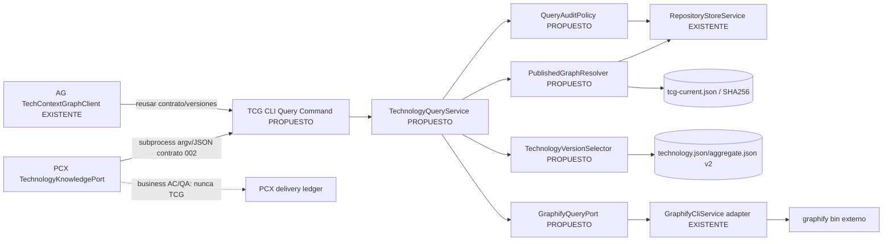
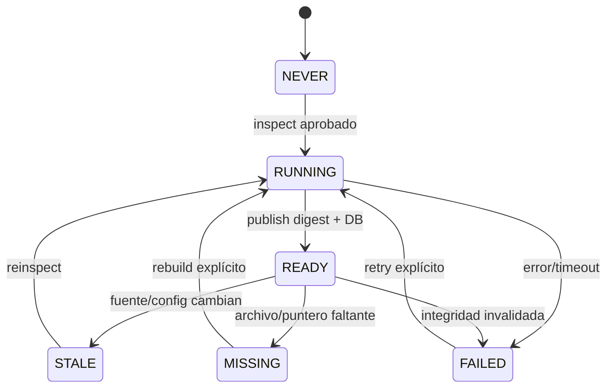
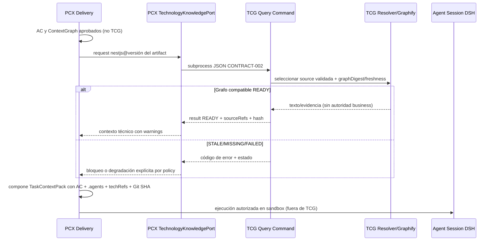

# 05 · Arquitectura objetivo: TCG como proveedor reproducible de conocimiento tecnológico

> **Todas las interfaces/módulos de esta página son PROPUESTOS**, salvo que indiquen ruta existente. La estrategia es **extensión incremental**, no microservicio, reescritura, nuevo MCP ni orquestador.

## 1. Decisión arquitectónica

Mantener un **NestJS CLI monolito modular** y añadir una capa de aplicación/puertos **solo en el seam de consulta**. `GraphifyCliService.inspectLocked`, `RepositoryUpdateService`, store SQLite, publicación por puntero y tecnología agregada **se reutilizan**. No mover todas las clases ni cambiar DB en una sola migración. El dato autoritativo de TCG es **qué repositorios fueron aprobados y qué generación técnica está publicada**, nunca la intención de negocio.



### Propuesta de módulos (rutas nuevas deben entenderse como **PROPUESTAS**)

| Layer | Reutilización | Responsabilidad nueva mínima |
|---|---|---|
| `src/commands/` | CLI `repository:*` | `technology:query`, `technology:explain`, `technology:path` o un único `technology:context` con `--action`: contrato estable, `--json`, exit statuses; naming a aprobar |
| `src/services/` | GraphifyCliService, ControlService | `technology-query.service.ts`: validación application, safe selection, query result, mapping error |
| `src/models/` | StoredRepository, statuses | `technology-context-result.ts`: DTO discriminado, `schemaVersion:'1.0'` |
| `src/services/` | resolver de outputs y fingerprint | `published-graph-resolver.service.ts`: pointer/hash/realpath, immutable generation, source/graphify version |
| `src/services/` | TechnologyGraphService | selector de familia/versión exacta usando technology.json v2; **no** agregado inter-version |
| `src/services/` | runProcess (shell:false) | `GraphifyQueryPort` y `GraphifyCliQueryAdapter` o una interfaz corta que envuelva captura con límites |
| `src/persistence/` | repository store | política para guardar metadatos de query sin texto; migraciones append-only solo si necesarias |
| `src/cli.module.ts` | DI providers | registrar comando y servicios (test de DI real) |
| `test/` | Jest + fixtures existentes | contract fixtures JSON, negative paths, QA multiOS |

## 2. Modelo de consulta y respuesta (diseño TypeScript)

```typescript
// PROPUESTA: src/models/technology-context-result.ts
export type QueryAction = 'query' | 'explain' | 'path';
export type TechnologyResultStatus = 'READY' | 'STALE' | 'MISSING' | 'FAILED';
export interface TechnologyQueryRequestV1 {
  schemaVersion: '1.0';
  technology: string;                 // id del catálogo, no libre ejecución
  versionConstraint: string;          // versión/major explícita según contrato de selector
  question: string;
  action: QueryAction;
  secondNode?: string;                // solo path
  graphRevision?: string;             // hash o inspectionId ya publicado
  maxResults: number;                 // 1..N, presupuestado
  correlationId?: string;
}
export interface TechnologySourceRefV1 {
  repositoryId: string; repositoryKey: string;
  repositoryCommit: string | null;     // null si fuente no Git
  sourceFingerprint: string;
  graphDigestSha256: string;          // hex SHA256 sobre bytes de graph.json
  graphifyVersion: string;
  publishedAt: string;
  pointerInspectionId: string;
  fileRef?: string; lineStart?: number; lineEnd?: number;
}
export type TechnologyContextResultV1 = {
  schemaVersion: '1.0'; status: TechnologyResultStatus;
  technology: string; requestedVersion: string; resolvedVersion?: string;
  graphHash?: string; inspectionAt?: string; freshnessCheckedAt?: string;
  sourceRefs: TechnologySourceRefV1[];
  matches: Array<{ content: string; references: number[]; confidence: 'SOURCE'|'INDEX'|'INFERRED' }>;
  warnings: string[]; correlationId?: string; queryDurationMs: number;
  error?: { code: 'INVALID_INPUT'|'VERSION_MISMATCH'|'GRAPH_MISSING'|'STALE_GRAPH'|'INTEGRITY_FAILED'|'TIMEOUT'|'GRAPHIFY_UNAVAILABLE'|'QUERY_FAILED'|'SOURCE_CHANGED'|'OUTPUT_TOO_LARGE'; retryable: boolean; message: string };
};
```

**Importante:** esto es un **protocolo de diseño**, todavía no hay DTO ni JSON validado. `GraphifyCliService.query()` solo devuelve `{output,exitCode,durationMs}`; no intentar convertir prosa Graphify en citas `file:line` si el CLI no las entrega. En primera iteración, `matches=[]` con warning `UNSTRUCTURED_GRAPHIFY_OUTPUT` y `sourceRefs` a nivel repo/grafo si no hay refs de nodos verificables. Evitar cita ficticia.

## 3. Algoritmo de consulta segura (P)

1. Validar request (`schemaVersion`, acción allowlist, lengths, `maxResults`, `path` requiere `secondNode`, forbid shell flags/paths de usuario).
2. Resolver workspace explícito **aprobado** (no usar workspace actual implícito cuando PCX llama). Seleccionar repos `ACCEPTED && enabled`, no rutas absolutas recibidas del LLM.
3. Resolver tecnología exacta y versión: cotejar `technology.json` v2 `members` (core/technologyVersion, libs/technologyConstraints); **no** usar `aggregate.json` de familia mezclada para request versionada. Si no hay core compatible, `MISSING/VERSION_MISMATCH`.
4. Por miembro, leer `tcg-current.json` bajo raíz gestionada, validar normalización y `realpath` de graphPath, calcular SHA256 bytes y comparar `graphDigest`; comprobar publication/inspectionId con SQLite, `graphifyVersion`, sourceFingerprint, repoCommit.
5. Calcular **frescura** contra HEAD/status/fingerprint del repo en el momento de la consulta (costo acotado/cache con TTL *no promesa*); si difiere → STALE. `READY` exige digest + aprobación + compatibilidad + freshness y fuente observada.
6. Invocar Graphify por `runProcess` con args array, `shell:false`, timeout configurable acotado, captura máxima (actual `captureGraphify` 120 s sin maxResults), cancelación/terminación de proceso.
7. Normalizar salida JSON estricta: schema, sourceRefs y warnings; si Graphify no da referencias verificables no atribuir lines. Limitar/redactar contenido y no devolver tokens/paths de máquina.
8. Registrar una fila de auditoría **sin contenido sensible por defecto**; no registrar prompt/resultado completos salvo opt-in y política de retención.
9. Revalidar puntero/fingerprint/hash al terminar para detectar TOCTOU (si cambia → `STALE/INTEGRITY_FAILED`); devolver resultado idéntico para misma revisión, salvo campos volátiles explícitos.
10. PCX recibe `TechnologyContextResult`, aplica su policy si el contexto es optional/mandatory. No modifica ACL ni business state en TCG.

## 4. Estados y degradación

**Estado interno de inspección existente:** `NEVER | RUNNING | READY | STALE | FAILED | MISSING` (`repository-state.ts:L3`); estados contractuales consulta: `READY | STALE | MISSING | FAILED` (propuestos). Convertir `NEVER` y `RUNNING` a respuesta `MISSING` o `FAILED` **con warning y código granular**, conservando `inspectionStatus` opcional. No confundir `READY` de SQLite (última inspección) con `READY` de consulta con freshness comprobada.



| Resultado | PCX optional technology | PCX mandatory technology | TCG debe hacer |
|---|---|---|---|
| READY+sourceRefs | usar con límites de confianza | usar, registrar hash | no cambiar estado UC |
| STALE | warning+consulta sin contexto o fresh replan | `BLOCKED_TECH_CONTEXT` | no emitir texto como current |
| MISSING | avisar, sin fabricar refs | bloquear + hint de inspección | no lanzar inspect por efecto lateral de query |
| FAILED/TIMEOUT | warning, retry controlado por PCX | bloquear por código | cerrar proceso, no hang |
| INTEGRITY_FAILED | **bloquear aun si optional** por riesgo corrupción | bloquear | preservar última publicación válida; incident event |

## 5. Contrato CLI mínimo (P, sujeto a negociación)

```bash
# SOLO TRAS WP-01; estos comandos NO existen hoy.
tcg technology:query --workspace /safe/catalog --technology nestjs \
  --version 10 --question 'DTO validation decorators' --max-results 8 --json
# stdout: SOLO un TechnologyContextResultV1 JSON; stderr: diagnósticos sin secretos.
# exit: 0 READY; no cero para inválido/unavailable/integrity (documentar mapping estable).
```

**Transporte de integración:** subprocess con argv y JSON. No REST ni MCP TCG; `apps-generator` ya encapsula invocación `src/codegen/tech-graphs/tech-context-graph.client.ts:L50-L145` y `TechGraphLifecycleService` invoca `project:add`, `repository:inspect`, etc. PCX debe desarrollar su adapter en su propio repo.

## 6. Secuencia específica KwikVet UC-TH-001 (P)



**Invariante:** TCG no valida mismo país, dirección o RBAC de telehealth; esas son AC de PCX y QA independientes.

## 7. Seguridad, performance, observabilidad, rollback

- **Trust boundary:** versiones/roots/repo IDs estrictos; `realpath`, punteros confinados; NO cargar ejecutables indicados por el grafo; `process-runner.ts` existente ya usa `shell:false`, extender límites `maxOutputBytes` y abort signal.
- **Source injection:** contenido de README de tercero puede contener instrucciones. Devolver text como `untrustedKnowledge`, schema/hash/refs y data classification; sanitizar exposición de secretos.
- **Versioning:** CONTRACT-002 v1 incompat changes → v2, fixture JSON y consumer negotiation; compat `technology.json` v2 y sidecar AG `TechGraphMetadata` v1 **no tienen mismo esquema**.
- **Retries:** Graphify error transitorio con at most 1 retry idempotente **solo query**; rebuild nunca automático por consulta; consumer decide replan.
- **Observabilidad:** event `technology_query_started/resolved/rejected`, `correlationId`, duration, graphHash, status, reason; sin raw prompt/output por defecto; histogramas de latency y stale.
- **Rendimiento:** no cargar agregado de centenares de MB a memoria para toda query si Graphify consulta grafos por path; revisar y presupuestar selección de múltiples grafos por versión. LRU cache por digest, TTL limitado; no cache READY sobre fingerprint caducado.
- **Recovery:** publicación con generation pointer+digest existente; inspecciones huérfanas reconciliadas; probar crash antes/después de rename. Rollback por versión del CLI y conservar schema v1/v2 de artefactos; no borrar generaciones sin retención segura.
- **DI:** agregar providers concretos al `CliModule` ya existente, sin importación de paquetes internos de AG/PCX y sin duplicar Graphify.

## 8. Decisiones abiertas

`ADR-TCG-01`: nombre y forma de CLI; `ADR-TCG-02`: representación/version constraints; `ADR-TCG-03`: formato de referencias y Graphify output estructurado; `ADR-TCG-04`: TTL/freshness policy; `ADR-TCG-05`: si query puede registrar contenido; `ADR-TCG-06`: límite de output/cancel; `ADR-TCG-07`: estrategia de digest por miembro vs multi-graph. Ver [11-risks-and-decisions.md](11-risks-and-decisions.md).


---
