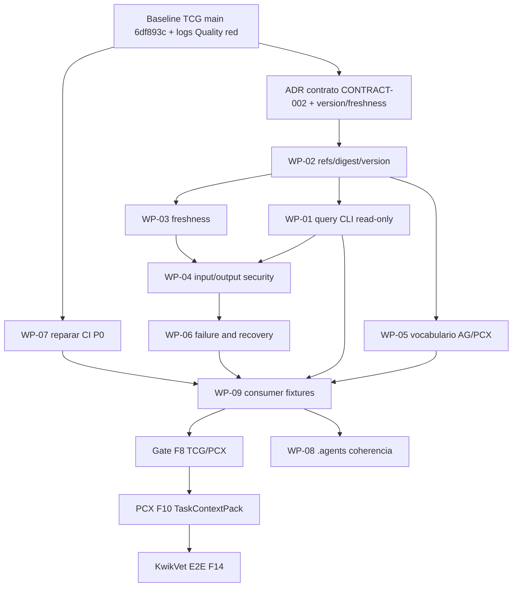

# 10 · Roadmap TCG y coordinación global F0–F15

## 1. Principios de ejecución

El prompt especializado exige **solo planificación en etapa 2**. La fase de implementación de los 9 paquetes se abre **por nueva autorización** y con rama/trabajo aislado del owner TCG. PCX es fuente autoritativa de UseCase Delivery; TCG aporta conocimiento tecnológico por ref. Una mejora CLI TCG no desbloquea por sí misma C6 AG↔PCX, Git worktrees ni un piloto integrado. El run CI rojo es un gate P0 independiente.

## 2. Fases globales y rol TCG

| Fase | Global owner(s) | Dependencia | Rol TCG / producto final | Gate verificable |
|---|---|---|---|---|
| **F0 (P0)** | AG+PCX | inicial | **NO OWNER**; esperar C6 strict fixture, C7/C9 compatibles | CT-001/002/003 green en AG y PCX |
| F1 (P0) | PCX+AG | F0 | Consultado, no rediseñar negocio | ADR v6 sucesora aprobada |
| F2 | PCX+UI | F1 | Ninguna mutación | ramas caracterizadas y diff |
| F3 | AG+PCX | F0+F2 | Contexto tech opcional en artifact | NestJS + Vue/Nuxt profile multiartifacts C9 |
| F4 | PCX | F3 | TCG no Artifact Registry | registry revision/version |
| F5 | AG+PCX | F4 | TCG no ownership manifest | readiness y handoff por SHA |
| F6 | PCX | F5 | TCG no schema impact | UNKNOWN/BLOCKED/NO_CHANGE correctos |
| F7 | PCX | F6 | **Preparar** contrato TCG en paralelo | Delivery aggregate/DAG/ledger real |
| **F8** | **TCG+PCX** | F7 | **Owner CONTRACT-002 producer**; adapter consumer PCX, freshness+CI | TC-001..004 y fixtures bidireccionales, no HTTP inventado |
| F9 | PCX | F7 | NO Git leases | worktree boundaries + CAS/lease |
| F10 | PCX+Harness adapter | F8+F9 | Referencias TCG al TaskContextPack si READY | auth/isolated runner/events receipts |
| F11 | PCX+AG+QA | F10 | TCG no certifica UC | QA independiente por AC y code SHA |
| F12 | PCX | F11 | No REST TCG | OpenAPI Delivery v1 real |
| F13 | UI | F2+F12 | datos TCG visibles **a través de PCX** | cockpit per project permission |
| **F14 P0 SALIDA** | Todos | F13 | TCG scenario READY/STALE/MISSING en KwikVet | AC-TH-01..07, PRs y failure partial probados |
| F15 | PCX+AG+UI | F14 | TCG no overwrite | regeneración avanzada 3-way, pos-MVP |

## 3. Orden interno por gates y opciones de paralelismo

**WP-07** puede correr en paralelo al diseño del contrato; **WP-02** se recomienda antes de declarar `READY`. **WP-01** puede construir CLI con estado `MISSING` mientras WP-02 termina; **no publicar READY no certificada**. WP-08 debe actualizarse incrementalmente con cada WP y finalizar con proof de hashes del pack. **WP-09** necesita cumplimiento gates antes de afirmar PCX integrado.

## 4. Entregables por hito

| Hito | Entregables TCG | Bloqueantes externos | Abort / rollback |
|---|---|---|---|
| H0 Baseline | snapshot SHA, logs CI, `.agents` actual y ADR pendientes | permiso Git de escritura, Graphify bin | sin code changes |
| H1 CI sano | fix tests/fixture y workflow green Ubuntu+Windows por SHA | runners disponibles | no saltar suites |
| H2 Contrato producer | JSON Schema V1, command help/`--json`, errors, fixtures | elegir versión/consulta action | desactivar CLI nuevo, TUI sigue |
| H3 Provenance | pointer/digest/source SHA/version/`STALE` tests | Graphify refs reales | bloquear consulta, preservar graph |
| H4 Seguridad | no shell/realpath/output caps/query logs, Git consent | decisiones Git/privacidad | feature flag o revert CLI |
| H5 Cross-repo | AG/PCX fixture green, CONTRACT-002 signed by SHA | F7 PCX, C6 F0 | PCX desactiva context optional, no negocio perdido |
| H6 Piloto | TCG optional techRefs en ContextPack KwikVet | AG+PCX+UI+DSH+QA | partial failure no marca integrated |

## 5. Ejemplo de failure recovery entre dos repos

Si PCX inicia un task backend con TCG READY, pero antes de construir el pack cambia el código fuente del framework y TCG pasa a STALE: TCG devuelve `STALE` y la referencia anterior sigue preservada; PCX invalida/rehace el pack según policy y **no** da por integradas unidades. No se reinicia Graphify dentro de un request por sorpresa ni se corrige código en AG. Si AG no tiene build verde, la capacidad se marca no certificada aunque TCG esté READY. Ningún estado externo se “arregla” inventando datos.

## 6. Dependencias de seguridad y decisiones humanas

- **Git:** rama `agents-total-integration` sin overwrite de usuario; esta etapa está **bloqueada por 403**, requiere conexión autorizada/operador humano. Para fase 3, worktree aislado y proceso de aprobación distinto al implementador.
- **Versiones:** TCG utiliza versiones de tecnología detectadas, AG publica target/profile/version, PCX selecciona plan; las tres tienen semánticas diferentes, contract mapping explícito.
- **QA:** F8 TCG green no basta F14; cada AC debe tener evidence sobre SHA final.
- **Graphify:** fijar versión semántica y checksum, no usar output del sistema local como spec de formato sin pruebas.
- **Autonomía:** no incorporar `auto` del Superagent al catálogo; observar/pedir autorización para mutation Git.

## 7. Checklist antes de empezar fase 3

1. Verificar remote `main` SHA actual y resolver cualquier avance desde `6df893c`; comparar `.agents` antes de planificar cambios.
2. Confirmar permits para branch/commit y si hay trabajo previo; no reescribir.
3. Ejecutar setup en checkout TEMPORAL, no workspace usuario (ver AGENTS critical rules).
4. Obtener run CI red y reproducir causas sin modificar tests a ciegas.
5. Congelar contrato CONTRACT-002 con owners AG y PCX (Schema V1 fixtures); nada de REST.
6. Autorizar específicamente mutaciones Git/SQL/FS, schema migrations y exposure de logs.
7. No declarar F8 cerrado hasta producer+consumer green por SHA.

---
