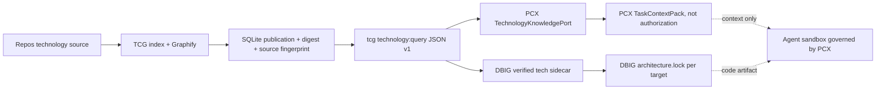

# ARGEns v6 — Tech Context Graph (TCG) · Tres planes ejecutables para certificar tecnología e integrar PCX/DBIG

**Documento de PLAN, no implementación ni certificación nueva.** Repo `charlietyn/tech-context-graph`, rama `agents-total-integration`, baseline inspeccionada `125a7535cecb67bc75798a21bcedcb9ada432027` (2026-11-10); mantener `main` intacto. Leer `.agents/**`, `docs/agents-total-integration/06-cross-repository-contracts.md`, `08-implementation-plan.md`, `09-testing-strategy.md`, `12-implementation-evidence.md` y plan DBIG `23-plan-ejecutable-contratos-evidencias-certificacion-local-2026-11-10.md`.

## Realidad inspeccionada y límites

TCG v4 es **NestJS CLI + SQLite local**, no un backend REST multinodo. Implementa `tcg technology:query --workspace ... --technology nestjs --version 10 --action query --question ... --json` en `src/commands/technology-query.commands.ts`; `TechnologyQueryService`, `PublishedGraphResolverService`, `TechnologyContextResultV1` y schema `docs/contracts/technology-context-result.v1.schema.json`. `READY/STALE/MISSING/FAILED`, códigos 0/3/4/2, hashes y provenance están definidos en código. El handoff `12-implementation-evidence.md` informa un **smoke Linux real de Graphify 0.9.102 en un commit anterior**, no certificación del HEAD actual ni de consumidores PCX/AG. `.github/workflows/graphify-real-integration.yml` instala `graphifyy==0.9.102` con `uv` y ejecuta `scripts/smoke-graphify-real.cjs`.

**TCG es fuente de contexto tecnológico de solo lectura; nunca autoriza WorkUnits, AC, agentes, commits o aplicación del generador.** PCX decide `mandatory/optional`; DBIG consume referencias de arquitectura pinadas, sin inventar una API TCG. `schemaVersion:'1.0'` CONTRACT-002 **no** es igual a `technology.json` v2, ni `capabilityHash` C6 equivale a `graphHash`.



## PLAN TCG-1 · Reproducibilidad local, Graphify real y contratos de consulta (P0)

**Owner de código:** TCG. **Estado actual:** query v1 y smoke sintético previamente implementados; falta certificar commit presente, Windows/WSL, tamaños y consumer. No reimplementar `technology:query` ni crear REST si el CLI ya funciona.

| WP | Tarea | Evidencia PASS / negativo |
|---|---|---|
| TCG-01 | Congelar Node/npm/Python/uv/Graphify y sistema operativo; comprobar instalación real `graphifyy==0.9.102` y `graphify --version` antes de indexar | sha, `graphify-version.txt`, `environment.json`; binario real comprobado |
| TCG-02 | `npm ci`, `npm run lint:types`, `npm test`, `npm run build` en commit final; ejecutar CLI compilado `--help` y query `MISSING` con workspace temporal; stdout JSON único sin TUI | Jest, TypeScript, build 0; exit status CLI 4 para `MISSING` |
| TCG-03 | Repetir `node scripts/smoke-graphify-real.cjs` con Git/SQLite/Graphify real; `READY` fuente intacta y `STALE` tras edición de fuente, hash/fingerprint reproducibles | `ci-evidence/graphify-smoke.json` con nodeCount>0, graphDigest y validación; no secretos |
| TCG-04 | Extender smoke controlado a `query/explain/path` con dos nodos del grafo real; errores Graphify TIMEOUT, binario ausente, JSON malformado, output > límite | errores typed `FAILED`, no comandos shell ni procesos huérfanos |
| TCG-05 | Ejecutar mismo test Windows + WSL2 Ubuntu; rutas con espacios, realpath, symlink/junction, permisos FS, repos dirty/untracked | logs separados por OS; no falsa igualdad de rutas ni acceso exterior |
| TCG-06 | Reproducir `READY` por versión mayor exacta `nestjs@10` y `nestjs@11`; agregados de librerías compatibles y selección `core` único | no mezcla core 10/11; ambiguos/version no soportada ⇒ `MISSING/VERSION_MISMATCH` |

**Comandos locales comprobados con `package.json` y workflow:**
```bash
git clone https://github.com/charlietyn/tech-context-graph.git
cd tech-context-graph && git switch agents-total-integration
git rev-parse HEAD
node --version && npm --version && python3 --version
npm ci
npm run lint:types
npm test
npm run build
# Fuera del npm install, instalar Graphify REAL; confirmar uv/PATH primero:
uv tool install 'graphifyy==0.9.102'
graphify --version
GRAPHIFY_BACKEND=none GRAPHIFY_QUERY_LOG_DISABLE=1 node scripts/smoke-graphify-real.cjs
# CLI propio: en un workspace NUEVO y explícito, debe dar MISSING sin efectos
node dist/main.js technology:query --workspace /tmp/tcg-cert-empty \
  --technology nestjs --version 10 --action query --question WelcomeService --json
```
La consulta MISSING tiene exit code **4 esperado**, no es un test pasado por sí solo: capturar exit code de forma explícita (en PowerShell: `$LASTEXITCODE`). Antes de smoke, crear `/tmp/tcg-cert-empty` en Linux; usar `mktemp -d` y limpiarlo al final. El smoke real escribe `ci-evidence/graphify-smoke.json`: mantenerlo fuera de commits, revisar `.gitignore` y no publicar texto sensible.

## PLAN TCG-2 · Provenance y referencia tecnológica compartida TCG→PCX/AG (P0/P1)

| WP | Implementación/validación | Condición de PASS / negativo |
|---|---|---|
| TCG-07 | Verificar contrato `TechnologyContextResultV1` y JSON Schema v1; exportar fixture canonical `READY,STALE,MISSING,FAILED,VERSION_MISMATCH` desde el CLI real y Ajv | schemaVersion 1.0, `sourceRefs`, resolvedVersion, graphHash, timestamps; negative unknown fields |
| TCG-08 | Resolver `tcg-current.json`, SQLite y grafo publicado: SHA-256 recalculado, repository commit y sourceFingerprint, GraphifyVersion, inspectionId. Dirty/untracked y cambios antes/después ⇒ STALE | no `READY` si digest/pointer/source se altera; no sourceRef falso |
| TCG-09 | Definir interoperabilidad con `src/codegen/tech-graphs/verified-tech-graph-reference.ts` de DBIG: sidecar `schemaVersion:1` vs publicación TCG `technology.json:v2`, mapeo explícito sin renombrar hash ni inventar versión | fixtures producer-consumer idénticas; error/version mismatch tipado |
| TCG-10 | CONTRACT-002 vía CLI tipado consumido por PCX mediante ProcessRunner argv, timeout, max stdout, cancelación y allowlisted workspace (código del adapter **en PCX**, no modificar PCX desde este plan) | 4 estados y códigos preservados; optional warning / mandatory BLOCK; cero `READY` ficticio |
| TCG-11 | Normalizar semántica de provenance: `SOURCE` solo con refs que verifiquen file/line, `INDEX` para Graphify unstructured; prompts son datos no confiables, no instrucciones | sourceRefs no afirman líneas que Graphify no da; inject `ignore previous instructions` no ejecuta tools |
| TCG-12 | Versionado/compatibilidad: rechazo de schema v999, graphHash incorrecto, repoCommit de otra fuente, graphRevision stale, dos cores same major, query output excesiva | respuestas fail-closed; 0 import de módulos internos entre repos |

**Paths existentes a inspeccionar/editar:** `src/models/technology-context-result.ts`, `src/services/technology-query.service.ts`, `src/services/published-graph-resolver.service.ts`, `src/services/repository-fingerprint.service.ts`, `src/services/graphify-cli.service.ts`, `src/services/query-output-sanitizer.ts`, `docs/contracts/technology-context-result.v1.schema.json`, `test/fixtures/contracts/technology-context/v1/`. **No introducir dependencia de NestJS servidor en TCG ni decisión de approval/AC.**

**Test matriz cross-repo:** emitir fixtures TCG v1 en rama TCG; PCX valida en `TechnologyKnowledgePort` de lectura con input versionado y guarda `graphHash/sourceRefs/freshnessCheckedAt` en `TaskContextPack`; AG valida solo la tecnología/versión/architecture lock, sin tratar un contexto TCG `READY` como permiso de agentes. Si el consumo no existe, registrar `CONSUMER_MISSING`, no declarar PASS.

## PLAN TCG-3 · Seguridad, recuperación, rendimiento y certificación local (P1)

| WP | Trabajo verificable | Gate |
|---|---|---|
| TCG-13 | Procesos Graphify: `spawn(shell:false)`, stdout/stderr capped, cancel timeout, kill process tree, logs redacted; no pull/inspect/rebuild implícito desde query | 0 escrituras fuera `.tcg`, consultas read-only; timeout devuelve FAILED |
| TCG-14 | Recovery SQLite↔`tcg-current.json`: crash antes/después de rename/publicación, CAS pointer/digest y restore del último válido; no READY con pointer incompleto | restart sin corrupción y error explícito hasta reconciliación real |
| TCG-15 | Policy de fuentes: allowlist de directorios, `realpath`, symlink/junction, IDs duplicados, human ACCEPTED no se sobrescribe durante rescan; ignore config | path traversal, source outside, incompatible dual major ⇒ FAIL |
| TCG-16 | Test de rendimiento limitado: mini NestJS 10, mini NestJS 11 y repo mediano controlado; medir latencia query, memoria y tamaño de grafo sin cortar evidencia; presupuestos explícitos acordados | benchmark JSON con CPU/OS/RAM/versiones; no hardcode de métricas inventadas |
| TCG-17 | CI real `.github/workflows/quality.yml` y `graphify-real-integration.yml`: Ubuntu/Windows (si job existe), Graphify pin, artifacts sanitizados; correlación HEAD/runs | green en SHA exacto para todos los gates obligatorios; no sustituir logs ausentes |
| TCG-18 | Consolidar documentación `.agents`, EN/ES CLI, contratos, Runbook y PR Draft, con rollback y owner de cada consumer | documentación verificada con CLI `--help`, paths existentes y tests |

**Pruebas existentes:** `test/technology-query.service.spec.ts`, `test/graph-publication.spec.ts`, `test/repository-store.service.spec.ts`, `test/fixtures/contracts/technology-context/v1/*` según el handoff 12. Inspeccionar el árbol actualizado y ajustar rutas solo si el test está en otro directorio. Añadir pruebas adversariales para Graphify fake **separadas** del smoke real. Validar `Graphify 0.9.102` en Linux sin API LLM (`GRAPHIFY_BACKEND=none`) y seleccionar dos versiones core; las consultas semánticas pueden tener limitaciones en code-only, documentarlas en lugar de afirmar cobertura semántica completa.

### Plan local ordenado y decisiones de integración

1. Ejecutar `TCG-01`→`06` y guardar evidencia SHA/OS/versiones. Si Graphify real no está instalado, NO usar mocks para certificar real integration.
2. Ejecutar `TCG-07`→`12`, publicar fixture producer y remitir digest/contrato a PCX/AG. En PCX no abrir `TechnologyKnowledgePort` a un path arbitrario desde UI; consumir workspace registrado.
3. Ejecutar `TCG-13`→`18`, correr regresiones Windows/WSL2 y crash recovery. Registrar estado por plataforma.
4. Revalidar en PCX la policy mandatory/optional: `READY` con digest verificado puede incorporarse a ContextPack; `STALE/MISSING/FAILED` bloquean si obligatorio; si opcional solo warning tipado. Ni TCG ni DBIG elevan autoridad de negocio.

### Formato de evidencias de certificación (por SHA)

`docs/agents-total-integration/evidence/local/tcg/<sha>/` **propuesta**: `versions.json`, `ci-runs.json`, `typecheck.log`, `jest.json`, `build.log`, `graphify-real-smoke.json`, `query-ready.json`, `query-stale.json`, `query-missing.json`, `query-failed.json`, `provenance-digest.json`, `consumer-matrix.md`, `security-failures.json`, `performance.json`, `decision.md`. Nunca subir grafos que contengan código privado ni `.tcg` o secretos. Cada PASS debe tener `repo,ref,sha,command,exitCode,environment,artifactHash`; `SKIP` o `BLOCKED` jamás equivalen a PASS.

### DoD y rollback

**PASS TCG:** calidad, CLI real y Graphify pin real con READY→STALE, hashes coherentes, error codes y seguridad, tests multiversión y fixtures consumidas por PCX y AG. **PARTIAL:** smoke Linux anterior sin consumer, o Graphify fake solo. **BLOCKED:** runner/Graphify ausente, status desconocido, SHA no fijado, CI sin logs, grafos dirty o consumer no implementado. **Rollback:** conservar última publicación inmutable; invalidar pointer/selector nuevo con nueva generación; jamás editar historia SQLite para simular READY. **Siguiente etapa:** PCX TaskContextPack + DBIG architecture.lock con las fixtures aprobadas, sin habilitar Harness.
